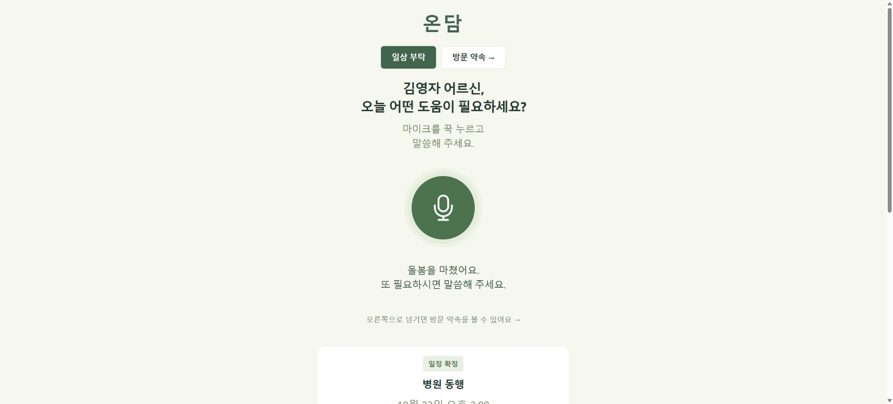
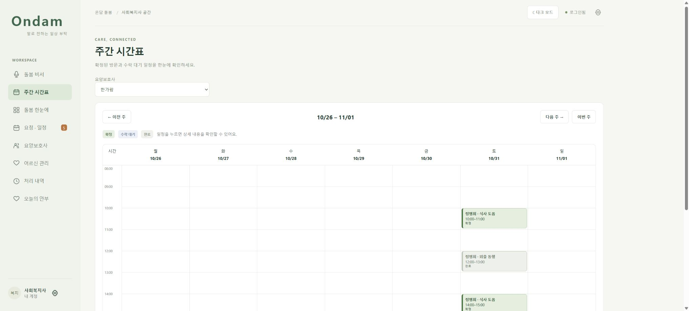
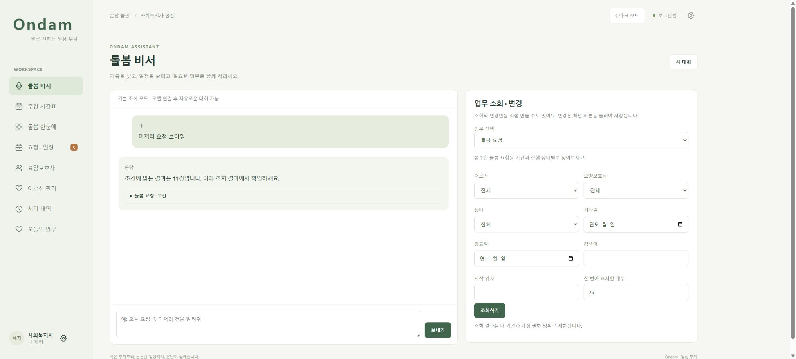

# 온담 — 말로 전하는 일상 부탁

어르신이 말로 도움을 요청하고, 내용을 확인한 뒤 보호사와 방문 일정을 연결하는 돌봄 PoC입니다.

**엘리스 AI 챌린지 2026 제출용**

기존 CLover를 기반으로 만든 파생 프로젝트입니다. 온담 이름·문자 로고, 일상 부탁 예시, 방문 약속 안내와 미확정 상태 설명을 보완했습니다. 원본 CLover는 별도로 유지하며, 새로운 AI 모델을 개발한 것으로 주장하지 않습니다.

## 심사자 안내

이 저장소는 **소스 코드와 화면 캡처로 제출하는 PoC**입니다. 상시 접속 웹 서비스는 운영하지 않습니다. 앱을 실행하지 않아도 아래 화면과 설명으로 흐름을 확인할 수 있습니다.

### 핵심 기능 3가지

1. **음성 부탁과 확인**: STT와 로컬 LLM이 필요한 도움을 해석하고, 사용자가 확인한 뒤 접수합니다.
2. **방문 약속 연결**: 시간·거리·중복 일정 규칙으로 배정하며 보호사 수락 후 확정합니다. 어려운 요청은 사람이 조율합니다.
3. **돌봄 비서**: 역할별 권한 안에서 일정·요청을 조회하고, 변경안은 사용자 확인 후 적용합니다.

## 실제 화면 캡처

아래 이름·연락처·주소·일정은 모두 개발용 가상 데이터입니다. 2026년 11월 15일 로컬 테스트 서버에서 촬영했습니다.

### 일상 부탁

큰 마이크 버튼과 발화 예시로 부탁을 시작합니다. 실제 음성 인식 정확도는 이번 시험에서 측정하지 않았습니다.



### 방문 약속 안내

확정과 수락 대기를 설명하고 주 단위로 방문 약속을 확인합니다. 이 화면은 일정이 없는 주의 안내 예시입니다.


### 주간 시간표

가상 일정의 확정·완료·대기 상태를 구분하고 이전·다음 주로 이동합니다.



### 돌봄 비서

가상 요청의 미처리 건수를 조회했습니다. **기본 조회 모드** 캡처이며 실제 LLM 응답 성능의 증거가 아닙니다.



## 검증 결과

- 자동 테스트 **368건 통과 / 실패 0건**
- 로컬 HTTP 업무 시나리오 **62건 통과 / 실패 0건**
- 브라우저: 로그인·조회·어르신 화면·방문 약속 전환·주간 이동 확인

[검증 범위와 한계](docs/VALIDATION.md)를 참고하세요. 이는 개발용 합성 데이터 검증이며 실제 사용자 정확도나 서비스 인증을 뜻하지 않습니다.

## AI와 사람의 역할

`음성 → STT 전사 → 로컬 Ollama LLM 해석 → 내용 확인 → 규칙 기반 배정 → 보호사 수락 → 일정 확정`

LLM은 요청 이해와 도구 선택을 담당합니다. 실제 권한 검사·일정 충돌 검사·변경 적용은 서버에서 수행합니다. 의료 판단과 응급 대응은 제공하지 않습니다.

## 로컬 실행

Node.js 22 이상과 npm이 필요합니다.

```sh
npm ci
```

`.env.example`을 `.env`로 복사하고 `PORT=3011`을 설정합니다. 음성 기능에는 별도 로컬 STT 서버와 Ollama 모델이 필요합니다.

```dotenv
PORT=3011
HOST=127.0.0.1
STT_URL=http://127.0.0.1:8000/v1/audio/transcriptions
STT_MODEL=whisper-1
OLLAMA_URL=http://127.0.0.1:11434
OLLAMA_MODEL=your-installed-model
AGENT_PROVIDER=ollama
```

위 주소·모델명은 예시이므로 실제 로컬 구성에 맞게 바꿉니다. 미설정 상태에서는 기본 조회 모드만 사용할 수 있으며 음성 인식 성공을 보장하지 않습니다.

```sh
npm start
```

로컬에서 `http://127.0.0.1:3011/app/`을 열고 최초 관리자 설정과 계정을 준비합니다. [계정 안내](docs/AUTH.md), [로컬 음성 안내](docs/LOCAL-VOICE.md)를 참고하세요.

## 공개 범위

실제 계정·사용자 데이터·녹음·비밀키·로컬 모델 파일·원본 붓글씨 이미지는 포함하지 않습니다. 테스트의 example.test 계정과 합성 데이터는 운영용이 아닙니다.
